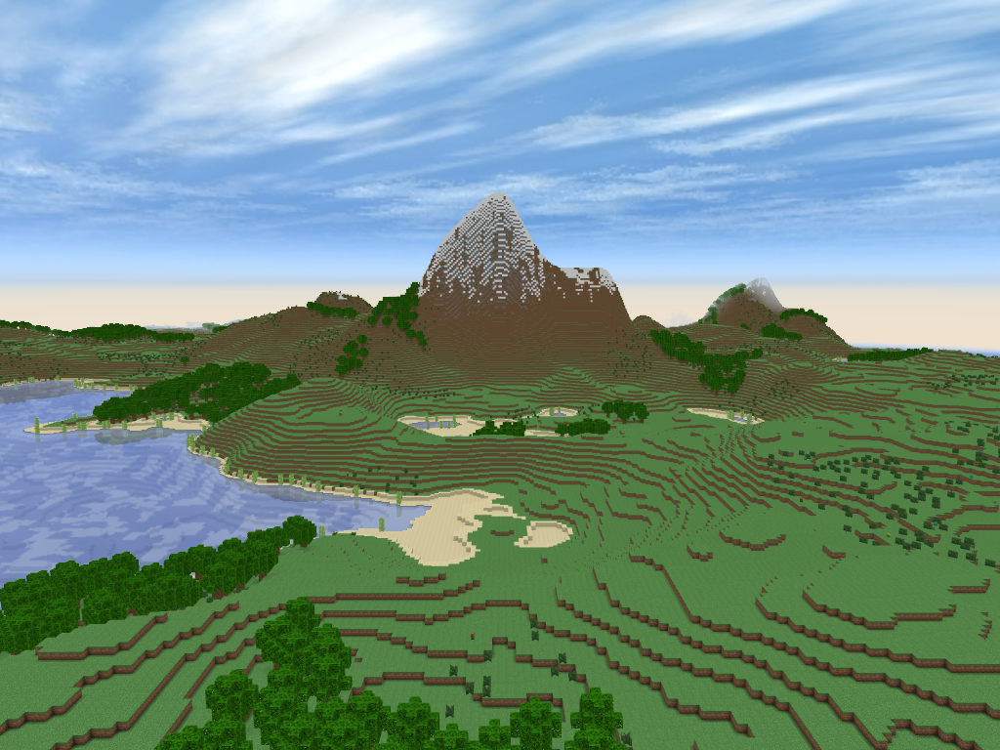

## RepGame

RepGame is a Minecraft clone written by @Repkap11 in C++.



## Play on Windows, Linux, Web, or Android
Build artifacts are available on https://www.repkap11.com/repgame

Windows: https://repkap11.com/repgame/RepGame.exe \
Linux: https://repkap11.com/repgame/RepGame-1-x86_64.AppImage \
Web (Web Assembly): https://repkap11.com/repgame \
Android: https://repkap11.com/repgame/RepGame.apk

## Selecting Build Platforms
RepGame supports multiple platforms, all of which must be built on Ubuntu (or maybe any distro with the "apt" package manager).

Building for Linux and Windows is relatively easy, but building WASM, Android, AppImage, FlatPak, or with CUDA/HIP support will require more setup.

A bare `make` builds every platform, and `make install` pulls every toolchain (mingw-w64, nvidia-cuda-toolkit, hipcc, ...). For a quick Linux-only build, delete the platform makefiles you don't need — each one removed drops its targets from `make` and its packages from `make install`:
```bash
rm makefiles/{cuda,hip,flatpak,wasm,appimage,android,windows}.mk
```
Building WASM requires emsdk — `make emsdk_build` clones vanilla upstream emsdk into `emsdk/` and installs/activates it (override the location with `make wasm EM_ROOT=/path/to/emsdk/upstream`).

Building Android requires installing Android Studio and the required SDK and NDK versions.
Running a command line build at least once is required to add images and shaders to the build.
```bash
make android
```
After that first build, the project can also be built in Android Studio if desired.

Building with HIP support (AMD GPU accelerated terrain gen) requires the ROCm toolchain. HIP is enabled automatically when /usr/bin/hipcc is present; install it with:
```bash
make hip-install
```
The HIP kernels target generic code objects (gfx9 through gfx12 GPU families), so a single binary runs on every supported AMD GPU. This requires ROCm 6.0+ on the build machine. Builds without the toolchain (flatpak) link objects prebuilt by `make gpu-prebuilt` instead.

## Building the Code
Once you've narrowed down your build platforms, you can install the needed dependencies and build.
```bash
# You will need to type your password to install apt packages.
# Some files are also downloaded from www.repkap11.com
make install
make
```
Two asset trees are fetched by on-demand make targets (neither is needed to build or run):
```bash
make bedrock_samples_build # Mojang's resource pack; input for the blocks-import/mobs-import content importers
make mc_pack_build # Minecraft WAV sources for music/SFX (copyrighted, downloaded not tracked); without it the game builds silent
```
Alternatively, if you don't want to install packages on your Linux distro, you can build a portable AppImage inside docker.
The docker image targets Ubuntu 24.04 and builds SDL3 from source, so the resulting AppImage has a glibc floor of 2.38 and runs on most modern x86_64 Linux distros.
```bash
# Setup docker...
# Install the dependencies which aren't system dependencies.
make entt_build imgui_build appimage_build
# Building the docker image automatically cleans up any dangling docker images or volumes, including non RepGame ones.
make appimage-portable
```
## Running the Game
To play the game, run the final executable with a name for the world save, and a multiplayer server url. On Linux, worlds will be saved in ~/.repgame. On Windows, they are stored in the current directory.
```bash
./out/linux/release/RepGame World1 www.repkap11.com
```
The linux_debug build is compiled with "-g", no "-flto", no optimizations, and no FPS cap (to more easily see performance regressions).
The other builds are FPS capped so they don't burn your CPU/GPU.

Or use one of the make targets to build and run in 1 step:
```bash
make linux-run
make linux_debug-run
make appimage-host-run
make wasm-run
make windows-run #If you have wine installed.
```
Host and portable (Docker) builds use separate output directories (`out/linux` and `out/linux-portable`), so you can switch between them without a clean build.
However, when adding or removing CUDA or HIP support on the host, you should still do a clean build:
```bash
make clean
make
```

## Controls
- mouse to move camera, left click to mine/attack, right click to place/interact, middle click to pick block
- "wasd" "okl;" or arrow keys to move
- space to jump, fly up, or swim up
- "'" to sneak (prevents walking off edges), descend while flying, or sink while swimming
- "e" or "i" to open the inventory
- scroll-wheel to switch inventory page or hotbar slot
- "q" to drop an item, ctrl-q to drop the whole stack
- "p" to sprint, "f" to fly, "c" to no-clip
- "`" to toggle creative/survival
- "r" or "shift-r" to cycle render quality, "="/"-" to change render distance
- "m" to show meshing debug view, "g" for the ImGui debug overlay
- "v" to toggle vsync, F12 for a screenshot
- "n" to spawn a mob (debug)
- "ESC" for the pause menu (Ctrl-C exits)

The full binding list is in docs/player.md.

## Feature List
A short list of RepGame's features:

- Portable executable with all game assets and shaders statically linked into the executable.
- AppImage and Flatpak packaging.
- Instanced chunk rendering (glDrawElementsInstanced) with frustum culling, block meshing, rotatable textures (grass), and position-dependent index-buffer back-face culling.
- Perlin noise terrain gen with biomes, mountains, overhangs, custom trees, and decorations (flowers, bamboo, mushrooms, coral, seaweed).
- CUDA (NVIDIA), HIP (ROCm/AMD), and WebGPU (WASM) accelerated terrain gen.
- Flood-fill sky and block lighting stored in a mipmapped 3D light volume.
- Practically 0 dynamic memory allocations.
- Ray-tracing based block selection and collision physics.
- Creative and survival game modes; survival consumes placed blocks and collects mined ones.
- Persistent world and player saves (position, game mode, time, inventories, chunks).
- Inventory and hotbar rendered with an interesting ENTT based instanced rendering implementation.
- Crafting recipes and a crafting-table UI; dropped-item entities with pickup.
- Mobs with models/skins, AI, persistence, and per-species sounds.
- Redstone (blocks, dust, torches, lamps, pressure plates, pistons).
- Exploding TNT.
- Instanced block-breaking debris particles.
- Multiple block models (half-slabs, glass-panes, torches, flowers, chests)
- Chest inventories that persist and sync over multiplayer.
- Flowing water
- Music and positional SFX (digging, footsteps, mobs, water).
- OpenXR VR support (desktop Linux and Steam Frame).
- Flat worlds and a model voxelizer for importing 3D models as terrain (tools/model_to_world.py, `make car`).
- Day/night cycle with a textured sky box, synced between multiplayer clients.
- Distance fog blended toward the sky color.
- Deferred rendering pipeline with world space reflections in water. A standard forward rendering pipeline is also supported.
- Selectable render quality tiers (LOW, MEDIUM, HIGH, X_HIGH) with MSAA and mipmapped textures.
- ImGui debug overlay, and an env-var driven capture mode for deterministic screenshots.
- Multiplayer support on Linux, Android, and Web (WASM), with lit player avatars.
- Multiplayer server for Linux. Many clients handled by a single thread using non-blocking IO and epoll.
- Server-side storage of block diffs; chests, entities (mobs, item drops, block bodies), and the world clock sync between clients.
